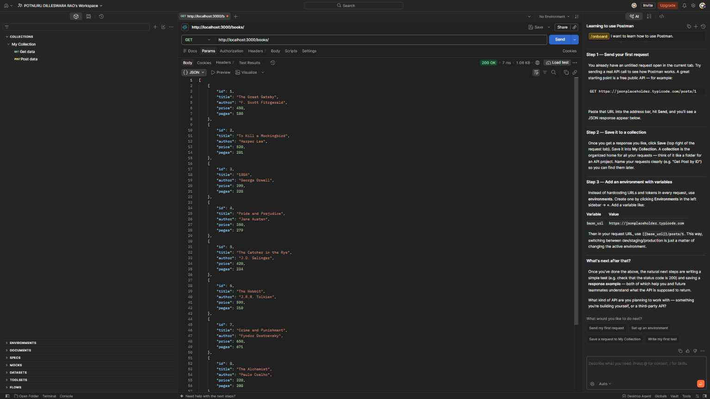
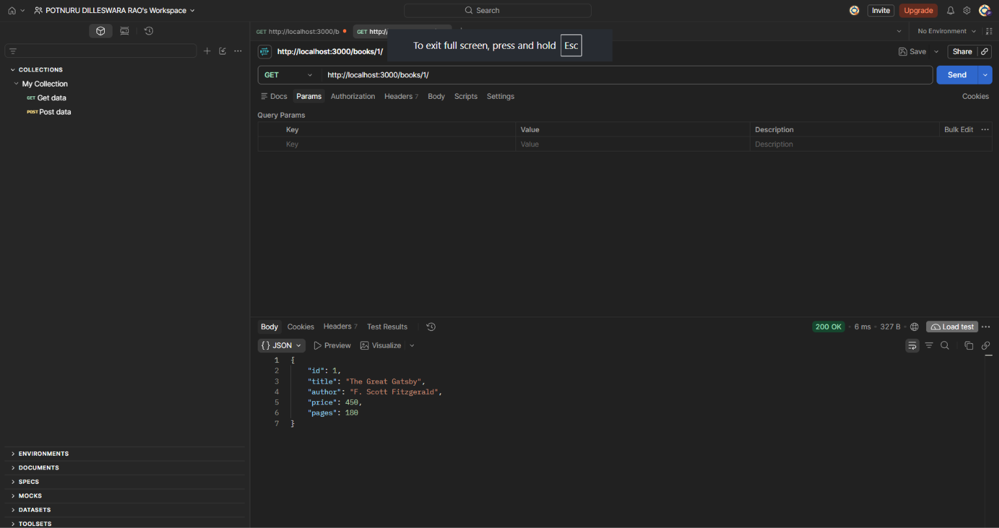

# Lab 2 – SQLite Database and CRUD Routes

## Student Details
- **Name:** Potnuru Dilleswara Rao
- **Registration Number:** 252U1R1198
- **Section:** CSE-2D
- **Course:** Backend Development Fundamentals

---

## Project Overview
This project implements a complete RESTful API for a Book Store management system using **Node.js**, **Express**, and **SQLite**. It demonstrates core backend engineering fundamentals including:
- Asynchronous database connection handling before starting the HTTP server.
- Safe execution of SQL queries using parameterized placeholders (`?`) to prevent SQL Injection vulnerabilities.
- Complete CRUD (Create, Read, Update, Delete) routes for book management.
- Robust error handling with appropriate HTTP status codes (`200 OK`, `201 Created`, `400 Bad Request`, `404 Not Found`, and `500 Internal Server Error`).

---

## Technologies Used
- **Runtime Environment:** Node.js (v18+)
- **Web Framework:** Express.js (`^5.3.0`)
- **Database Engine:** SQLite3 (`^6.0.1`)
- **Database Wrapper:** `sqlite` (`^5.1.1`) (Promise-based client for async/await)
- **Development Tool:** Nodemon (`^3.1.14`) (Auto-restarts server on file changes)

---

## Database and Table Structure

The project uses a single SQLite database file named `bookStore.db` containing the `book` table.

### Schema: `book` Table

| Column Name | Data Type | Constraints | Description |
| :--- | :--- | :--- | :--- |
| `id` | `INTEGER` | `PRIMARY KEY AUTOINCREMENT` | Unique identifier for each book |
| `title` | `TEXT` | `NOT NULL` | Title of the book |
| `author` | `TEXT` | `NOT NULL` | Author's name |
| `price` | `INTEGER` | `NOT NULL` | Price of the book in INR |
| `pages` | `INTEGER` | `NOT NULL` | Total number of pages |

### How to Initialize the SQLite Database

You can initialize and populate the database using any of the following methods:

#### Method 1: Using the Automated Initialization Script (Recommended)
Run the built-in npm script from the project root:
```bash
npm run init-db
```
This runs `initDb.js`, which automatically connects to `bookStore.db`, creates the `book` table if it doesn't already exist, and inserts 10 sample records.

#### Method 2: Using the SQLite CLI
Execute the SQL commands in `setup.sql` via the SQLite CLI:
```bash
sqlite3 bookStore.db < setup.sql
```

#### SQL Commands Reference (`setup.sql`)
```sql
-- 1. Create table 'book'
CREATE TABLE IF NOT EXISTS book (
  id INTEGER PRIMARY KEY AUTOINCREMENT,
  title TEXT NOT NULL,
  author TEXT NOT NULL,
  price INTEGER NOT NULL,
  pages INTEGER NOT NULL
);

-- 2. Insert 10 realistic sample records
INSERT INTO book (id, title, author, price, pages)
VALUES
  (1, 'The Great Gatsby', 'F. Scott Fitzgerald', 450, 180),
  (2, 'To Kill a Mockingbird', 'Harper Lee', 520, 281),
  (3, '1984', 'George Orwell', 399, 328),
  (4, 'Pride and Prejudice', 'Jane Austen', 350, 279),
  (5, 'The Catcher in the Rye', 'J.D. Salinger', 420, 234),
  (6, 'The Hobbit', 'J.R.R. Tolkien', 599, 310),
  (7, 'Crime and Punishment', 'Fyodor Dostoevsky', 650, 671),
  (8, 'The Alchemist', 'Paulo Coelho', 320, 208),
  (9, 'Clean Code', 'Robert C. Martin', 1150, 464),
  (10, 'Atomic Habits', 'James Clear', 699, 320);
```

---

## Installation and Execution Instructions

1. **Clone the repository:**
   ```bash
   git clone <repository-url>
   cd BDF-LAB-2
   ```

2. **Install project dependencies:**
   ```bash
   npm install
   ```

3. **Verify / Initialize the database:**
   ```bash
   npm run init-db
   ```

4. **Start the development server with Nodemon:**
   ```bash
   npm start
   ```
   *The server will start listening at:* `http://localhost:3000/`

5. **(Optional) Run automated endpoint test suite:**
   In another terminal:
   ```bash
   node testEndpoints.js
   ```

---

## API Endpoints and Expected Status Codes

| HTTP Method | Route Path | Description | Success Code | Error Codes |
| :--- | :--- | :--- | :--- | :--- |
| `GET` | `/books/` | Returns an array of all books | `200 OK` | `500 Internal Server Error` |
| `GET` | `/books/:bookId/` | Returns a single book matching the ID | `200 OK` | `400 Bad Request`, `404 Not Found`, `500 Internal Server Error` |
| `POST` | `/books/` | Inserts a new book into the database | `201 Created` | `400 Bad Request`, `500 Internal Server Error` |
| `PUT` | `/books/:bookId/` | Updates an existing book's details | `200 OK` | `400 Bad Request`, `404 Not Found`, `500 Internal Server Error` |
| `DELETE` | `/books/:bookId/` | Deletes a specified book from the database | `200 OK` | `400 Bad Request`, `404 Not Found`, `500 Internal Server Error` |

---

## Example Request and Response Bodies

### 1. `POST /books/`
- **Method:** `POST`
- **URL:** `http://localhost:3000/books/`
- **Header:** `Content-Type: application/json`

**Request Body:**
```json
{
  "title": "Clean Architecture",
  "author": "Robert C. Martin",
  "price": 899,
  "pages": 352
}
```

**Success Response (`201 Created`):**
```json
{
  "message": "Book Added Successfully",
  "bookId": 13
}
```

---

### 2. `PUT /books/:bookId/`
- **Method:** `PUT`
- **URL:** `http://localhost:3000/books/13/`
- **Header:** `Content-Type: application/json`

**Request Body:**
```json
{
  "title": "Clean Architecture: A Craftsman's Guide",
  "author": "Robert C. Martin",
  "price": 950,
  "pages": 360
}
```

**Success Response (`200 OK`):**
```json
{
  "message": "Book Details Updated Successfully"
}
```

---

## SQL Safety & Security

To protect against **SQL Injection** attacks, no user-supplied input is ever concatenated directly into SQL queries. Every route strictly uses parameterized SQL statements with `?` placeholders:

```javascript
// SAFE: Parameterized query prevents SQL Injection
const getBookQuery = `SELECT * FROM book WHERE id = ?;`;
const book = await db.get(getBookQuery, [bookId]);

const addBookQuery = `
  INSERT INTO book (title, author, price, pages)
  VALUES (?, ?, ?, ?);
`;
await db.run(addBookQuery, [title, author, price, pages]);
```

---

## Screenshots

### 1. Database View (`bookStore.db`)


---

### 2. GET All Books (`GET /books/`)


---

### 3. GET Single Book by ID (`GET /books/1/`)


---

### 4. POST Create Book (`POST /books/`)


---

### 5. PUT Update Book (`PUT /books/:bookId/`)


---

### 6. DELETE Book (`DELETE /books/:bookId/`)


---

### 7. Non-Existent Book - 404 Not Found (`GET /books/13/` After Deletion)


---

## Problems Faced and Solutions

### 1. Asynchronous Database Connection vs Server Startup Race Condition
- **Problem:** If Express begins listening for incoming HTTP requests before the SQLite database connection (`open()`) finishes resolving, incoming requests fail with a `TypeError: Cannot read properties of null (reading 'all')`.
- **Solution:** Encapsulated connection logic inside an `async initializeDBAndServer()` function. Used `await open(...)` to ensure the database connection succeeds before calling `app.listen(3000, ...)`.

### 2. SQL Injection Vulnerability in User Input
- **Problem:** Directly concatenating request parameters or body values into SQL strings (e.g. `WHERE id = ${bookId}`) exposes the database to SQL injection attacks and syntax errors from unexpected input.
- **Solution:** Strictly enforced parameterized SQL queries using `?` placeholders across all queries (`db.all()`, `db.get()`, and `db.run()`).

### 3. Handling Non-Existent Records on Update and Delete
- **Problem:** In SQLite, running `UPDATE` or `DELETE` on a non-existent ID does not throw an error; it simply affects 0 rows, which could falsely indicate success.
- **Solution:** Performed an initial `SELECT * FROM book WHERE id = ?;` check before executing update or delete operations. If the record does not exist, an immediate `404 Not Found` response (`{ "error": "Book Not Found" }`) is returned.

### 4. Handling Invalid or Non-Numeric Route Parameters
- **Problem:** If a client passes an invalid non-integer route parameter (such as `/books/abc/`), the query might execute unexpectedly.
- **Solution:** Added parameter validation using `isNaN(bookId)` to immediately reject invalid IDs with `400 Bad Request` (`{ "error": "Invalid Book ID. ID must be an integer." }`).

### 5. Parsing JSON Request Bodies in Express
- **Problem:** By default, Express does not parse JSON payloads in request bodies, leaving `request.body` undefined for `POST` and `PUT` requests.
- **Solution:** Added `app.use(express.json());` middleware at the top of the Express pipeline.
