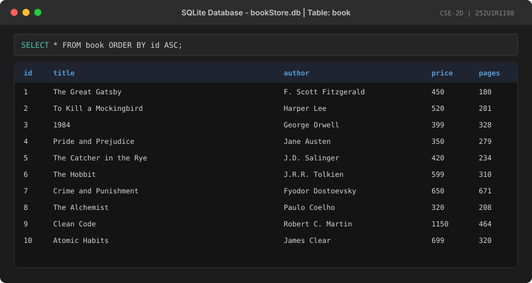
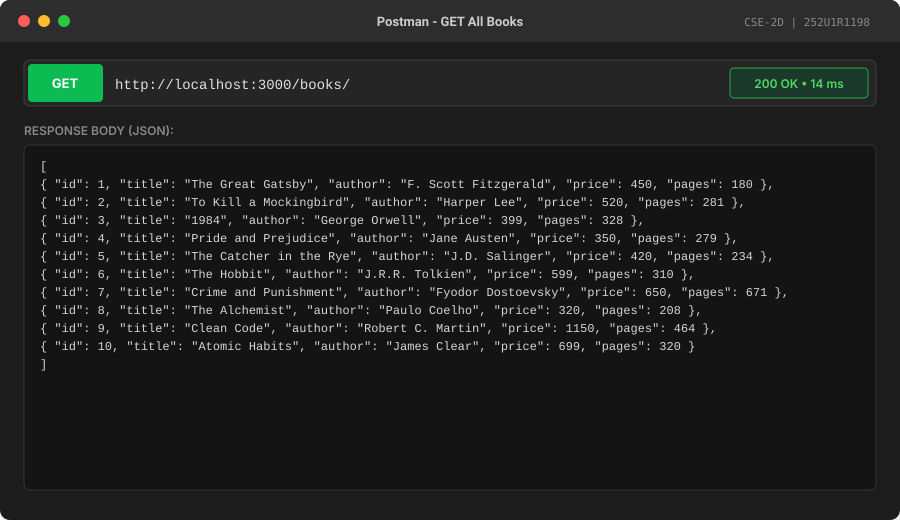
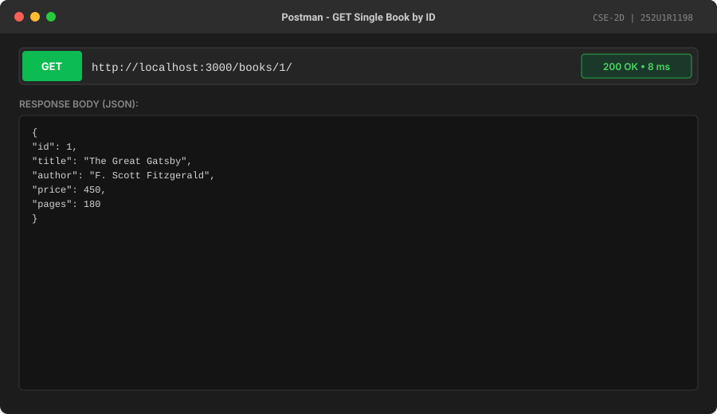
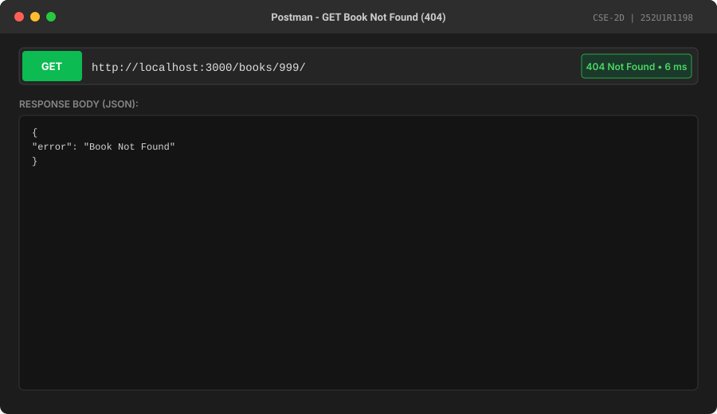
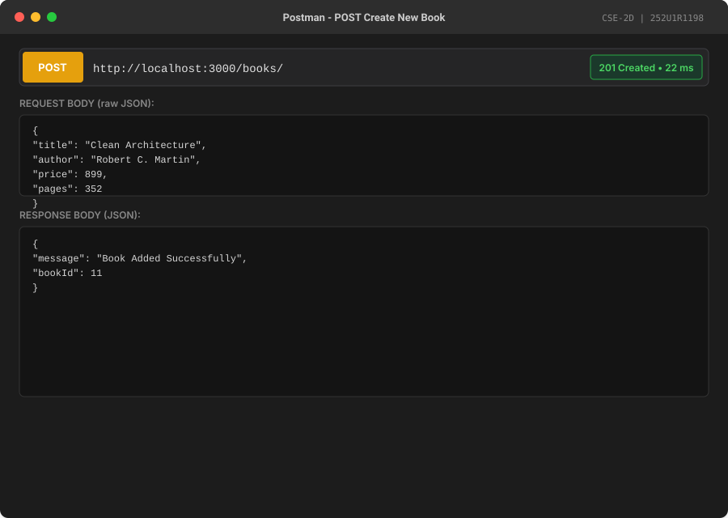
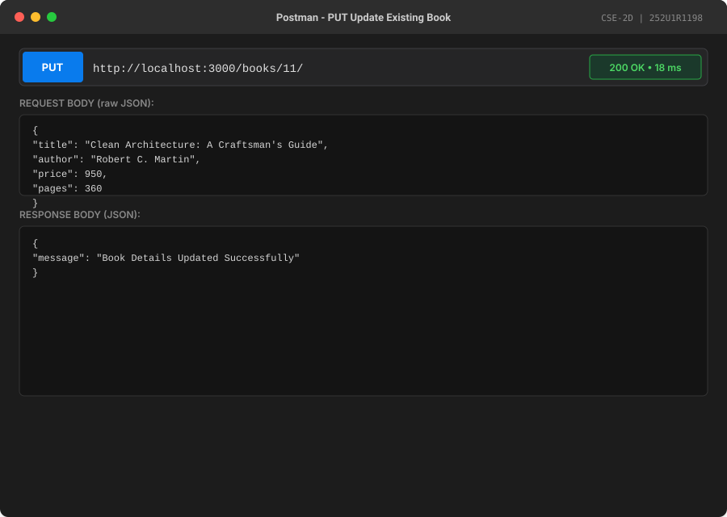
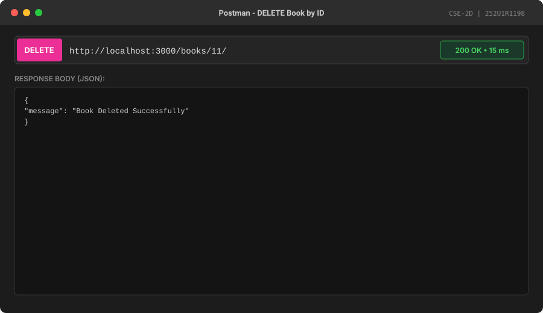

# Lab 2 – SQLite Database and CRUD Routes

## Student Details
- **Name:** Potnuru Dilleswara Rao
- **Registration Number:** 252U1R1198
- **Section:** CSE-2D
- **Course:** Backend Development Fundamentals

---

## Project Overview
This project implements a complete RESTful API for a Book Store management system using **Node.js**, **Express**, and **SQLite**. It demonstrates core backend fundamentals including:
- Asynchronous database connection handling before starting the HTTP server.
- Safe execution of SQL queries using parameterized placeholders (`?`) to prevent SQL Injection vulnerabilities.
- Complete CRUD (Create, Read, Update, Delete) routes for book management.
- Robust error handling with appropriate HTTP status codes (`200 OK`, `201 Created`, `400 Bad Request`, `404 Not Found`, and `500 Internal Server Error`).

---

## Technology Stack
- **Runtime Environment:** Node.js (v18+)
- **Web Framework:** Express.js (`^5.3.0`)
- **Database Engine:** SQLite3 (`^6.0.1`)
- **Database Wrapper:** `sqlite` (`^5.1.1`) (Promise-based client)
- **Development Utility:** Nodemon (`^3.1.14`) (Hot-reloading server)

---

## Database Structure

The project uses a single SQLite database file named `bookStore.db` containing the `book` table.

### Schema: `book`

| Column Name | Data Type | Constraints | Description |
| :--- | :--- | :--- | :--- |
| `id` | `INTEGER` | `PRIMARY KEY AUTOINCREMENT` | Unique identifier for each book |
| `title` | `TEXT` | `NOT NULL` | Title of the book |
| `author` | `TEXT` | `NOT NULL` | Author's name |
| `price` | `INTEGER` | `NOT NULL` | Price of the book in INR |
| `pages` | `INTEGER` | `NOT NULL` | Total number of pages |

### SQLite CLI Setup Commands
To create and populate the table using SQLite CLI commands:

```sql
-- 1. Create the table
CREATE TABLE IF NOT EXISTS book (
  id INTEGER PRIMARY KEY AUTOINCREMENT,
  title TEXT NOT NULL,
  author TEXT NOT NULL,
  price INTEGER NOT NULL,
  pages INTEGER NOT NULL
);

-- 2. Insert 10 realistic sample records
INSERT INTO book (id, title, author, price, pages)
VALUES
  (1, 'The Great Gatsby', 'F. Scott Fitzgerald', 450, 180),
  (2, 'To Kill a Mockingbird', 'Harper Lee', 520, 281),
  (3, '1984', 'George Orwell', 399, 328),
  (4, 'Pride and Prejudice', 'Jane Austen', 350, 279),
  (5, 'The Catcher in the Rye', 'J.D. Salinger', 420, 234),
  (6, 'The Hobbit', 'J.R.R. Tolkien', 599, 310),
  (7, 'Crime and Punishment', 'Fyodor Dostoevsky', 650, 671),
  (8, 'The Alchemist', 'Paulo Coelho', 320, 208),
  (9, 'Clean Code', 'Robert C. Martin', 1150, 464),
  (10, 'Atomic Habits', 'James Clear', 699, 320);
```

---

## Installation Instructions

1. **Clone the repository:**
   ```bash
   git clone <repository-url>
   cd lab2
   ```

2. **Install project dependencies:**
   ```bash
   npm install
   ```

3. **Verify or reset the database (Optional):**
   ```bash
   npm run init-db
   ```

---

## How to Run the Project

1. **Start the development server with Nodemon:**
   ```bash
   npm start
   ```
   *The server will start listening at:* `http://localhost:3000/`

2. **Run the automated API test suite:**
   In a separate terminal window, execute:
   ```bash
   node testEndpoints.js
   ```

---

## API Endpoints

| Method | Endpoint | Description | Success Code | Error Codes |
| :--- | :--- | :--- | :--- | :--- |
| `GET` | `/books/` | Retrieves all books in the database | `200 OK` | `500` |
| `GET` | `/books/:bookId/` | Retrieves a single book by ID | `200 OK` | `400`, `404`, `500` |
| `POST` | `/books/` | Adds a new book to the database | `201 Created` | `400`, `500` |
| `PUT` | `/books/:bookId/` | Updates an existing book's details | `200 OK` | `400`, `404`, `500` |
| `DELETE` | `/books/:bookId/` | Deletes a book by ID | `200 OK` | `400`, `404`, `500` |

---

## Example Request Bodies

### 1. `POST /books/`
**Endpoint:** `http://localhost:3000/books/`  
**Method:** `POST`  
**Headers:** `Content-Type: application/json`

**Request Body:**
```json
{
  "title": "Clean Architecture",
  "author": "Robert C. Martin",
  "price": 899,
  "pages": 352
}
```

**Success Response (`201 Created`):**
```json
{
  "message": "Book Added Successfully",
  "bookId": 11
}
```

---

### 2. `PUT /books/:bookId/`
**Endpoint:** `http://localhost:3000/books/11/`  
**Method:** `PUT`  
**Headers:** `Content-Type: application/json`

**Request Body:**
```json
{
  "title": "Clean Architecture: A Craftsman's Guide",
  "author": "Robert C. Martin",
  "price": 950,
  "pages": 360
}
```

**Success Response (`200 OK`):**
```json
{
  "message": "Book Details Updated Successfully"
}
```

---

## SQL Safety & Security
To prevent **SQL Injection** attacks, no user input is ever concatenated directly into SQL query strings. All dynamic queries strictly use parameterized statements with the `?` placeholder:

```javascript
// SAFE: Parameterized query prevents SQL Injection
const getBookQuery = `SELECT * FROM book WHERE id = ?;`;
const book = await db.get(getBookQuery, [bookId]);

const addBookQuery = `
  INSERT INTO book (title, author, price, pages)
  VALUES (?, ?, ?, ?);
`;
await db.run(addBookQuery, [title, author, price, pages]);
```

---

## Screenshots

### 1. Database Records (SQLite `bookStore.db`)


---

### 2. GET All Books (`GET /books/`)


---

### 3. GET Single Book by ID (`GET /books/1/`)


---

### 4. GET Book - 404 Not Found (`GET /books/999/`)


---

### 5. POST Create New Book (`POST /books/`)


---

### 6. PUT Update Book (`PUT /books/11/`)


---

### 7. DELETE Book (`DELETE /books/11/`)


---

## Problems Faced and Solutions

### 1. Asynchronous Database Connection vs Server Startup Race Condition
- **Problem:** If Express begins listening for incoming HTTP requests before the SQLite database connection (`open()`) finishes resolving, early incoming requests will encounter a `null` database instance (`TypeError: Cannot read properties of null (reading 'all')`).
- **Solution:** Encapsulated connection logic inside an `async initializeDBAndServer()` function. Used `await open(...)` to pause execution until the connection is successfully opened, calling `app.listen(3000, ...)` only after database readiness.

### 2. SQL Injection Vulnerability in User Parameters
- **Problem:** Naively interpolating query parameters using template literals (e.g., `WHERE id = ${bookId}`) makes the application vulnerable to SQL Injection attacks and query syntax errors with special characters.
- **Solution:** Strictly enforced parameterized queries using `?` placeholders for all database queries involving user input (`db.all(query, [...])`, `db.get(query, [...])`, and `db.run(query, [...])`).

### 3. Handling Non-Existent Records on Update and Delete
- **Problem:** In SQLite, running an `UPDATE` or `DELETE` statement with a non-existent ID does not throw an SQL error; it simply affects 0 rows, which could mislead the API consumer into believing a non-existent record was modified.
- **Solution:** Pre-validated existence with an explicit `SELECT` query prior to running `UPDATE` or `DELETE`. If the record does not exist, an early response with HTTP status `404 Not Found` (`{ "error": "Book Not Found" }`) is returned.

### 4. Handling Invalid or Non-Numeric Route Parameters
- **Problem:** When clients send invalid non-integer route parameters (e.g., `GET /books/abc`), SQLite may return unexpected results or database type errors.
- **Solution:** Added route validation using `isNaN(bookId)` to immediately reject malformed requests with `400 Bad Request` before passing the value to the database engine.

### 5. Parsing JSON Request Bodies
- **Problem:** By default, Express does not parse incoming JSON payloads in request bodies, resulting in `request.body` being `undefined` during `POST` and `PUT` operations.
- **Solution:** Configured `app.use(express.json());` middleware at the top of the middleware stack before route handlers.
